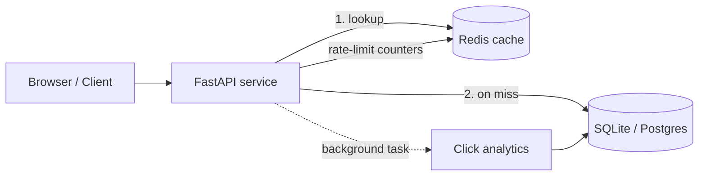

# ✂️ Snip: URL Shortener

> A production-style URL shortener with a clean web UI, Redis caching, rate limiting, and a click-analytics dashboard.
> Built to demonstrate backend fundamentals: caching, API design, security, testing, and deployment.

**🔗 Live demo:** [https://url-shortener-slj4.onrender.com](https://url-shortener-slj4.onrender.com) &nbsp;|&nbsp; **📖 API docs:** [https://url-shortener-slj4.onrender.com/docs](https://url-shortener-slj4.onrender.com/docs)

*Hosted on a free tier, so the first load after idle can take 30–60 seconds to wake up.*


## Screenshots


**Fig 1: Shorten a link.** Create a short link with an optional custom alias and expiry.
---


**Fig 2: Click analytics.** 7-day click trend with browser, device and referrer breakdowns.
---

## What it does

Paste a long link and get a short one. Optionally pick a custom alias and an expiry time, then track how people use your link.

| Feature | Details |
|---|---|
| **Short links** | Collision-free codes generated from a Base62-encoded database ID |
| **Custom aliases & expiry** | Choose your own alias; links can expire after 1 hour, 1 day or 7 days |
| **Analytics dashboard** | 7-day click chart plus browser, device and referrer breakdowns |
| **Secure deletion** | Each link has a secret owner token; deleting it takes effect immediately |
| **Fast redirects** | Redis read-through cache, with analytics recorded off the request path |
| **Abuse protection** | Per-IP rate limiting; blocks localhost, private IPs, self-links and reserved aliases |

## Tech stack

**Python 3.12 · FastAPI · SQLite · Redis · Docker · GitHub Actions · pytest · Vanilla JS**

## Architecture



**Redirect path:** check the cache first. On a miss, read the database and fill the cache. Respond with a `302`. The click is recorded afterward in a background task, so analytics never slow the redirect.

## Key engineering decisions

| Decision | Why | Trade-off |
|---|---|---|
| Base62 of an auto-increment ID | No collisions and no retry loop | Codes are sequential; add an ID scrambler if guessability matters |
| Redis read-through cache | Reads vastly outnumber writes | Possible staleness, so TTL is capped at link expiry and cache is invalidated on delete |
| `302` instead of `301` | Browsers don't cache it, so every click is counted | More server traffic than a `301` |
| Sliding-window rate limiter | Exact limits with no burst at window edges | More memory per client than a token bucket |
| Fail-open on Redis errors | Redis outage doesn't take the service down | Rate limiting is briefly off during an outage |
| Delete tokens stored as SHA-256 hashes, compared in constant time | A database leak doesn't expose owner credentials | No account system, so a lost token can't be recovered |
| Redis optional (in-memory fallback) | Runs anywhere, easy to test | In-memory cache isn't shared between workers |

## API

```bash
# Create a short link
curl -X POST $BASE/api/shorten -H "Content-Type: application/json" \
  -d '{"url":"https://example.com","alias":"demo","ttl_seconds":3600}'

# Follow it (302 redirect)
curl -i $BASE/demo

# Analytics: totals, 7-day trend, browsers, devices, referrers
curl $BASE/api/stats/demo

# Delete (needs the token returned when the link was created)
curl -X DELETE $BASE/api/links/demo -H "X-Token: <delete_token>"
```

| Method | Endpoint | Purpose |
|---|---|---|
| `POST` | `/api/shorten` | Create a link |
| `GET` | `/{code}` | Redirect to the original URL |
| `GET` | `/api/stats/{code}` | Click analytics |
| `DELETE` | `/api/links/{code}` | Delete a link (token required) |
| `GET` | `/health` | Health check and cache backend |

Interactive docs are available at `/docs`.

## Run locally

```bash
git clone https://github.com/hemeshwar09/URL-shortener.git
cd URL-shortener
pip install -r requirements.txt
python -m uvicorn app.main:app --reload     # http://localhost:8000
```

With Redis, using Docker:

```bash
docker compose up --build
```

## Testing

```bash
python -m pytest -q
```

17 automated tests run on every push via GitHub Actions. They cover:
redirects and expiry, cache hits, rate limiting, alias conflicts, blocked/internal URLs,
token-protected deletion with cache invalidation, and the analytics breakdown.

## Deployment

Deployed on Render as a Docker web service ([live site](https://url-shortener-slj4.onrender.com)). Free-tier hosting sleeps after inactivity and uses an ephemeral disk, so links reset on redeploy. Moving to managed Postgres would remove that limit.

## What I'd build next

- Replace SQLite with Postgres and add read replicas
- Batch click writes through a queue (SQS or Kafka) instead of per-request inserts
- User accounts so link owners can manage links across devices
- QR codes and password-protected links
- Scheduled cleanup of expired links

## Author

**Hemeshwar** · [GitHub](https://github.com/hemeshwar09)
